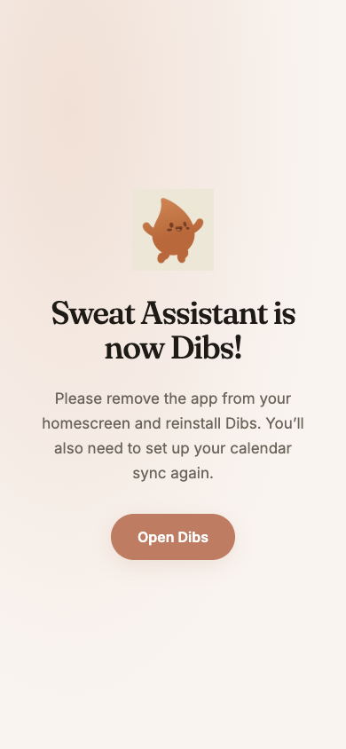

# Dibs domain migration — 2026-11-07

Owner authorized publication, the extra dev/experiment origins, and the short legacy holding pages. Source release: `964e04f` on `teams`, pushed without merging master. Each app and the landing reuse their existing Oracle container and database; no new automation worker or published host port.

| Origin | Role |
|---|---|
| https://dibs.fit | Canonical marketing site |
| https://app.dibs.fit | Production Dibs |
| https://dev.dibs.fit | Existing dev database/environment |
| https://experiment.dibs.fit | Existing experiment database/environment |
| https://www.dibs.fit | Temporary redirect to apex |

After final tunnel cutover, all three old app hostnames show the exact requested notice, with every Open Dibs button pointing to production `https://app.dibs.fit`. The old marketing hostname temporarily redirects to `https://dibs.fit`. Only the old GET/HEAD `/api/calendar/<token>.ics` routes proxy to the matching environment. Other old APIs return 410, and old browser deep links show the notice. No cross-origin API write redirect is introduced. The old worker is replaced by a small unregister/cache-retirement worker; all legacy notice responses are no-store.

## Verification output

```text
npm test: 121/121 server suites passed
Client: 117 test files passed; 959 tests passed
npm run build:client: built in 1.09s (existing >500 kB chunk warning)
Targeted config-required: 5/5 checks passed
Calendar domain migration: stable class/window UIDs and sequences; new feed links PASS
spa-fallback: all checks passed
nginx: configuration file /etc/nginx/nginx.conf test is successful
Parallel-stage new-origin probes: 36 PASS
Final legacy notice probes: 15 PASS
Final dev/experiment protected root: 302 to Access; health: 200
Final old/new dev/experiment feeds: 200 / conditional 304; private headers
```

The parallel-stage new-origin probes, taken before reattaching the test-environment Access apps, cover health/config, API and admin authentication denial, API JSON 404, clean SPA paths, invalid-feed 410, manifest id/scope/name, no worker TTL rewrite, and versioned asset cache headers. Every staged machine-response probe checks the absence of `cf-mitigated`. Valid dev/experiment feeds passed 200 text/calendar and ETag 304 with private cache headers on both origins. No production feed is currently enabled; production invalid-token behavior was checked instead. Calendar regeneration retained all dev UIDs (26/26 and 25/25) and experiment UIDs (22/22 and 26/26), including booking-window events where present. URL namespaces now change independently of permanent UID namespaces.

All three database `integrity_check` results were `ok`. Account, linked gym, Team, Team member, auto-book and auto-upgrade counts matched pre-migration backups. Existing non-domain environment values, including encryption configuration, were checked unchanged. No DB reset, VAPID rotation, provider configuration change, booking/cancel/purchase, or notification send was performed. Poller cycles and normal scheduler initialization were observed after restart; the production scheduler is idle because no pending auto-book exists.

## Cloudflare / TLS

Five explicit proxied CNAMEs point at the existing Oracle tunnel. The existing ingress entries and catch-all were preserved. The `dibs.fit` zone alone has Always Use HTTPS on, minimum TLS 1.2, and Browser Cache TTL 0 (respect origin headers). SSL mode remains Full; the encrypted tunnel terminates at a local Docker HTTP hop. No unnecessary origin certificate was installed. The validated public chain/SANs cover `dibs.fit` and `*.dibs.fit`, expiring 2027-02-05; TLS 1.3 was negotiated. Public HTTP-to-HTTPS redirects were checked for all four main origins.

The new zone retains the relevant AI-crawler and Brotli-body block rules, with enabled actions read back. Bot Fight remains off, BIC remains enabled, and script/security protections were not broadly disabled. Landing HSTS retains max-age but no longer includes subdomains. API responses default to private no-store; valid calendar 200/304 use private no-cache, max-age=0; worker/manifest revalidate; hashed assets remain immutable. Public production worker headers no longer contain max-age=14400. After restoring Access, the user’s authenticated Chrome session reached both new test welcome pages; direct same-origin worker/manifest fetches again returned 200 no-cache, and API config returned 200 private no-store, without challenge headers. Anonymous protected-root requests independently returned 302 to Access. The old wingfield.tech zone's global settings were not changed.

Access is preserved on the test environments: `dev.dibs.fit` uses the old dev Everyone/Access-login policy (app `a0017193-9858-4fd3-b462-f6c456f436b0`); `experiment.dibs.fit` uses Allow Piers (app `d798b285-4f26-4402-9e58-dcf9efb89b5b`). Both anonymous roots return 302 to Access. Matching calendar/health bypasses are app `81be8b1f-6c86-4d7e-8ea6-3b4cf71752d7`. Existing old dev/experiment calendar bypass apps were changed to notice-only host bypasses after their tunnel routes moved to Nginx. The retired old dev secondary hostname was removed from the legacy Psycle Access app; all its other settings and policy were confirmed unchanged. Production remains public with application authentication. The parallel-stage dev/experiment responses were publicly probed before this Access migration was reattached; app endpoints still required their normal app authentication throughout.

Access limitations: the configured Cloudflare token denies Page Rules, Cache Rules and Configuration Rules visibility; Cache Rules write was explicitly denied. Certificate-pack permission is unavailable, but the actual public TLS chain was validated. The ruleset list and Workers routes were inspected; no new-zone Worker route existed. Effective public responses and source privacy headers were verified repeatedly rather than claiming a complete privileged edge-policy audit. IPv4 passes; this Mac has no usable IPv6 connection, so IPv6 transport remains unverified.

## Browser and device limits

Real user Chrome via CDP was used, with one agent-owned tab reused. Baselines: old marketing site and signed-in old production Home. The holding page was checked at mobile width with exact copy/button; the dev fresh welcome/Log In surface was checked during parallel staging. New-origin full credential login, physical iPhone installation, owner push delivery/tap and native Apple/Google calendar subscribe/refresh require the owner's credentials/device interaction and are not claimed passing. Fresh login, new install, notification permission and calendar setup are intentionally required on the new origin; server accounts and settings remain available. No origin-storage migration bridge was built.

Pre-publication checks cached NXDOMAIN on the home resolver. Public and then local upstream resolvers returned Cloudflare addresses, but macOS mDNSResponder retains a separate negative entry (~2,250 seconds at diagnosis). Apex/app Chrome navigation remains limited by that local cache. Chrome host-cache clearing and unprivileged dscacheutil flushing did not clear it; privileged flush was unavailable. No household or OS DNS configuration was changed; no user action is required for public availability. Real Chrome verified all three public legacy notices; apex/app public TLS/config/body/asset checks used independently resolved Cloudflare addresses. This limitation is not reported as a completed browser flow.

## Rollback

Per-service secret backups are outside Git: `/home/ubuntu/services/<service>/rollback-domain-20261107/{env,image,app.db}`. SQLite backups use the native WAL-safe backup API. Landing HTML, Nginx, compose and image records are under `/home/ubuntu/services/dibs-landing/rollback-domain-20261107/`; that directory also contains private Cloudflare baseline snapshots. No token-bearing feed URL is committed or printed.

To reverse cutover, first restore the saved Access app destinations/policies and remove only the three newly-created Dibs Access apps, taking care to retain the unrelated legacy Psycle policy. Then restore only the changed tunnel entries from the captured config first, restoring old app routes before altering new-host availability. Restore each service `.env` from its saved `env`, retain its permanent CALENDAR_UID_NAMESPACE, and use the saved immutable image with the existing compose service and data directory. Restore the landing Nginx/HTML/compose and saved image if needed. Recreate one service at a time, verify docker ps and health, and remove only the five new DNS records if abandoning these origins. Restore only changed dibs.fit settings/rules from the snapshot. Do not restore SQLite simply to reverse a domain change; current user writes must survive. Old DNS/certs are retained for rollback and the direct calendar-feed overlap.

A 24-hour settling review and physical-device acceptance remain follow-up checks; do not retire the old feed paths until their use is settled. Old marketing redirects remain temporary through this interval.

Gemini Flash performed bounded instruction/source/reference retrieval, one grounded Cloudflare documentation lookup, and startup-log triage; used claims were checked against source, API read-back and exact log lines. The grounded lookup supplied an incorrect Cache Rules action example; it was corrected from the actual API model before the attempted write, which was denied. No Gemini output was applied as an unverified source fact.

Final targeted old-worker purge was denied (Cloudflare authentication error). All three actual public old-worker responses nevertheless returned HTTP200, Cache-Control:no-store and CF-Cache-Status:BYPASS with the retirement script; previously cached client copies can settle naturally. No wingfield.tech global TTL was changed.


